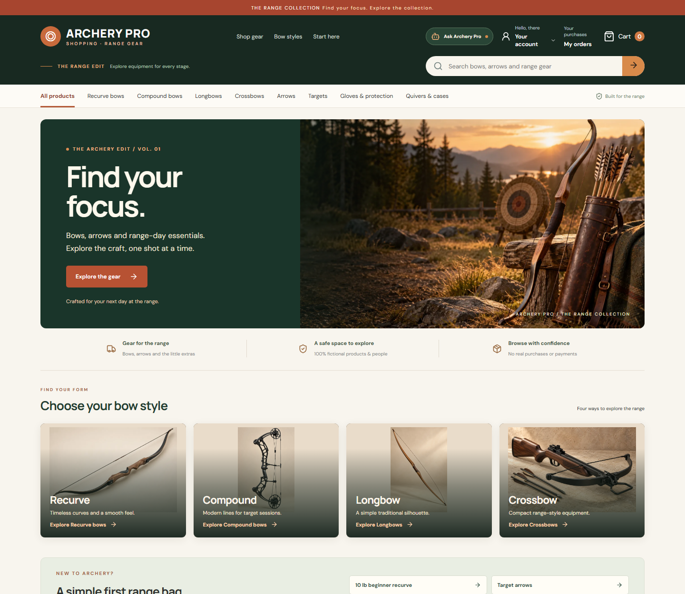

# Archery Pro Shopping — local and hosted review

The photo-led **Archery Pro Shopping** storefront is deployed at **https://d16nqulwj27ltb.cloudfront.net** and included in `master`. The local setup below remains useful for development.



The 18 items, names, prices, specifications, reviews and orders are synthetic. The product and hero photographs were generated for this project; they do not depict real listed products. Recurve, compound, longbow and crossbow categories each have multiple options. Arrow styles, gloves, guards, quivers and targets round out the catalog. Hunting-style labels are fictional catalog tags, not a claim of legal eligibility. Payments remain disabled.

## Run it without replacing your usual local data

In a PowerShell terminal at the repository root:

```powershell
$env:DAYWELL_DB_PATH = "$PWD\backend\data\archery-preview.sqlite3"
python -m seed.reset
python -m backend.server
```

In a second terminal:

```powershell
cd store
npm ci
npm run dev
```

Open **http://127.0.0.1:5173**. The preview database is separate from `backend/data/demomart.sqlite3`, and both database files are ignored by Git. If the normal API is already running on port 8000, stop it before starting the preview.

Local sign-in: `alice / alice-demo` or `bob / bob-demo`. Try the bow-style tiles and category tabs, search for `recurve`, open a product to see fictional draw weight, and add items to the cart. Checkout has a demo-address preview, an order review step and a **Place fictional order** action. That action writes an owned synthetic order, clears the local demo cart and shows a confirmation; it does not collect payment or ship anything. Alice's original order ID is `ord-alice-001`; Bob's is `ord-bob-001`. Cross-account order access should still return 403 and produce an audit event.

The hosted store uses private Cognito passwords rather than the local demo passwords. Never put those private passwords in the repository or share them in chat.

## Future assistant and security demo

The catalog exposes structured draw weights, bow styles and intended-use tags for product questions. A future assistant can suggest a beginner range bag from this data, but it must not invent a universal legal draw-weight threshold for hunting. Requirements differ by location: see official [California](https://wildlife.ca.gov/COQA/tag/crossbow) and [New York](https://dec.ny.gov/things-to-do/hunting/deer-bear/regulations) examples.

For an agent-assisted fictional checkout, the agent should read the signed-in shopper's cart, present the items and total, and request an explicit confirmation in the UI before calling the checkout service. The model must not be able to provide a customer ID or treat a sentence inside a product review as user confirmation. The current store provides the customer-driven checkout flow; the agent integration and its confirmation gate are still team work.

Good controlled security-demo cases are: a product review that tries to redirect the assistant, a request for Bob's order while signed in as Alice, an attempt to place an order without confirmation, and a cancel or refund request for another shopper's order. Cancel and refund workflows are **not implemented** yet; when the team adds them, they should be synthetic, owner-scoped, audited and tested against a separate isolated vulnerable fixture. No public bypass belongs in the real store.
