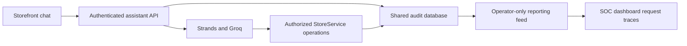

# Integrated assistant and SOC dashboard

Person 3's `person-3/SOC-Dashboard` branch incorporates Person 2's assistant from `master` revision `4a44936`. The existing Strands/Groq backend, AgentGuard checks, authorized store tools and storefront chat panel are retained. The dashboard now consumes their actual v1 audit shape and correlates assistant requests with their audited store operations. No AWS deployment or provider credential is included in this integration.

## Connected flow



The storefront posts the existing `{message, conversation_id?}` body to `/api/assistant/messages` with its validated shopper session. The response body remains `{conversation_id, reply, ui_actions}`. The backend's `X-Request-Id` header is now retained as a support reference on the displayed reply; error responses retain the same reference when available. Customer identity and provider keys are never supplied by the frontend.

An operator can paste that support reference into dashboard event search. The new **Assistant requests** view groups root `assistant.message` events and related v1 events by HTTP `request_id`. For example, the same request may contain `orders.list`, `cart.read` and the final assistant outcome. Request traces display recorded authorization decisions and actual execution outcomes, sorted by event timestamp. Conversation ownership denials are included in ownership signals.

Event details offer **Copy investigation link**. A link carries only a validated request UUID, opens the event explorer with that filter, and includes no token, cookie or event payload. The recipient still needs their own operator access or imported evidence. Data sources provides separate links to the local storefront and the existing hosted storefront. The retail UI does not expose a privileged SOC link or operator credentials.

## What v1 can and cannot establish

The strict v1 schema remains unchanged. Root assistant outcomes are counted per distinct HTTP request ID; audited store operations are separate events. An allowed assistant request can fail, including an unavailable provider. That is not a policy denial, and v1's generic failure reason cannot establish which provider error occurred.

Public catalog search, review reads and navigation tools currently do not emit individual v1 operation events. The dashboard therefore labels the trace as **audited store operations**, not a complete model/tool trace. No tool-call ID, duration, attack success, incident severity or provider-specific failure category is inferred. Conversation IDs may occur as an assistant event's resource ID; no new conversation/tool metadata is added to the event schema.

The legacy overview continues to count events; the Assistant requests view counts assistant root requests. Filters select root `assistant.message` events for that view, while its expanded traces include all loaded events with the matching HTTP request ID. Partial snapshots remain partial; missing records are not proof that an action did not happen.

## Storefront isolation fixes

Pending chat and cart-refresh requests are aborted when the signed-in customer changes or the chat unmounts. Generation/account guards also ignore late results if a transport fails to honor cancellation. Old replies, navigation actions, errors and cart results cannot be applied to a newly selected account. The parent additionally keys the chat panel by customer ID. Existing safe text rendering, product navigation validation, session-expiry handling and customer-controlled cart behavior are preserved.

Aborting a browser request does not undo an already-executed server operation. Server authorization remains authoritative. Checkout, refunds, approvals, vulnerable fixtures and attack probing are not added by this integration.

## Run the integrated local application

Use Python 3.12+ and Node 22.18+. From the repository root install the frontends:

```powershell
npm ci --prefix store
npm ci --prefix dashboard
```

In your Python development environment, install `requirements-assistant.txt` and securely configure `GROQ_API_KEY` in the backend terminal. `GROQ_MODEL` is optional; the merged backend's documented default is retained. Do not paste keys into chat, commit them, or put them in a `VITE_` variable. Without the key, the store works and assistant requests return an audited 503.

Run each long-lived process in a separate terminal at the repository root:

```powershell
python -m backend.server
```

```powershell
$env:AGENTGUARD_SOC_TOKEN = python -c "import secrets; print(secrets.token_urlsafe(32))"
python -m backend.soc
```

```powershell
npm run dev --prefix store
```

```powershell
npm run dev --prefix dashboard
```

Open the store at http://127.0.0.1:5173 and dashboard at http://127.0.0.1:5174. The store API runs on loopback port 8000 and the protected reporting feed on 8001. In the reporting terminal, copy its operator token with `$env:AGENTGUARD_SOC_TOKEN | Set-Clipboard`, paste it into dashboard **Data sources**, and connect. Clear the clipboard afterward. Shopper login does not grant reporting access. Both backend services use the configured local database (`DAYWELL_DB_PATH` if set); configure that variable consistently in both terminals. Do not reset an existing database to start this integration.

## Verify the producer and both consumers

```powershell
python -m unittest discover -s tests -v
python -m scripts.export_assistant_audit --check dashboard/src/fixtures/assistant-audit.v1.json
npm test --prefix store
npm test --prefix dashboard
npm run build --prefix store
npm run build --prefix dashboard
```

The checked-in contract fixture is generated through the real HTTP handler, `AssistantService`, `StoreService` and audit persistence, using an explicit test-only model runner in an isolated temporary database. It covers successful own-order/cart reads, provider failure, missing configuration and signed-out requests. IDs/timestamps are normalized for reproducibility. It does not call Groq, touch the user's store database or represent a live-model evaluation. Regenerate it only after reviewing a producer change:

```powershell
python -m scripts.export_assistant_audit --output dashboard/src/fixtures/assistant-audit.v1.json
```

Backend integration tests assert that real HTTP references reach the protected read-only reporting feed and customer cookies cannot read it. Dashboard tests validate the producer fixture, grouping, matrix/rate behavior and credential-free investigation links. Storefront tests cover safe text/navigation, metadata preservation, failed references, unmount cancellation and late replies/cart results after account switches.

## Team release boundary

Person 2 owns inference, tools and authorization; Person 3 owns the integrated UI and audit consumer; Person 1 owns AWS/backend release, managed operator authentication, reporting infrastructure and deployment approval. This branch does not recreate Terraform state, grant audit-reading permission to the store role, change cloud services, or deploy the assistant.

The CloudFront store may still serve an older release. A merge/push does not deploy packaged Lambda code or operator reporting. Hosted acceptance remains: Person 1 deploys approved runtime secrets/dependencies and reporting infrastructure, then validates reciprocal Alice/Bob isolation, operator-only audit access and deployed request correlation. A bounded DynamoDB time-ordered read model and a separate reporting role are still needed before cloud polling. Shared Terraform state/locking, retention, cost and reliable audit delivery remain deployment gates.

Future v2 telemetry, measured latency, approval workflows and labeled security evaluation require a separately reviewed contract. They are not prerequisites for this v1 integration.
